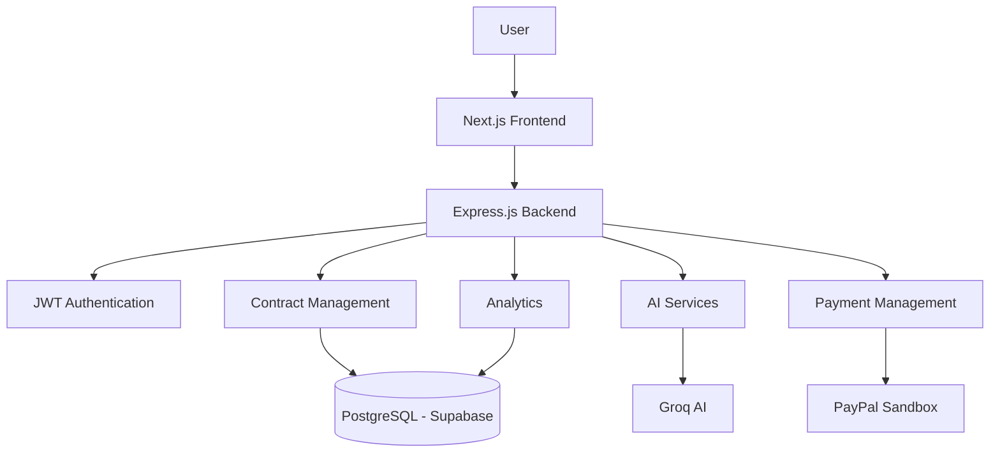
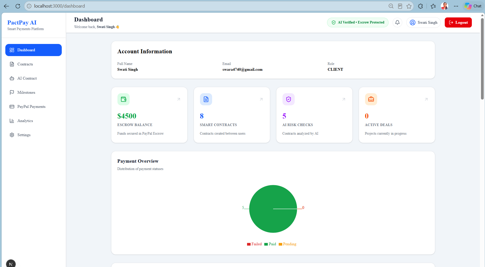
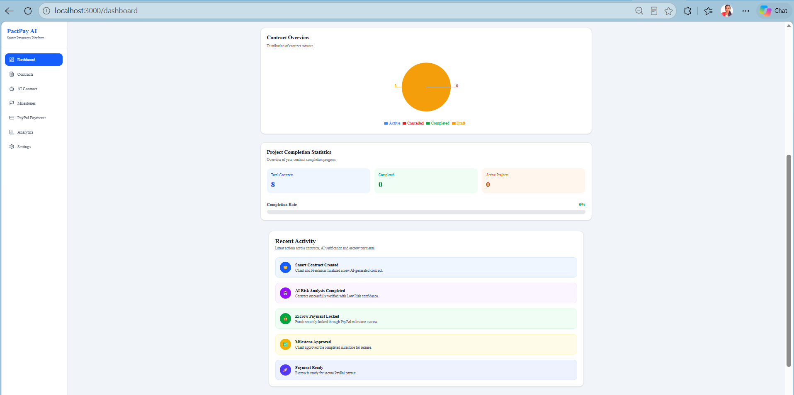
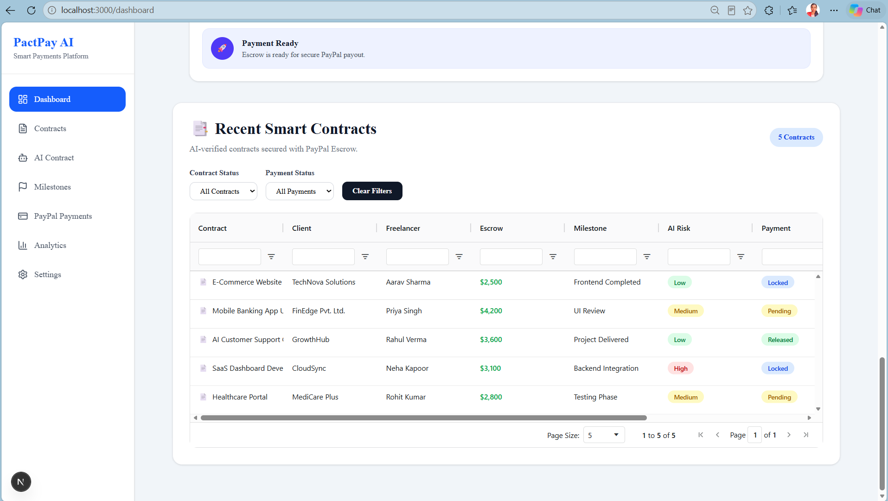
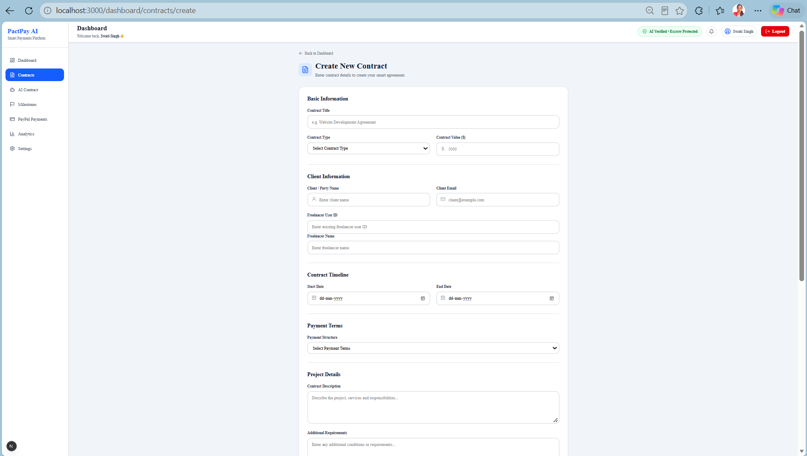
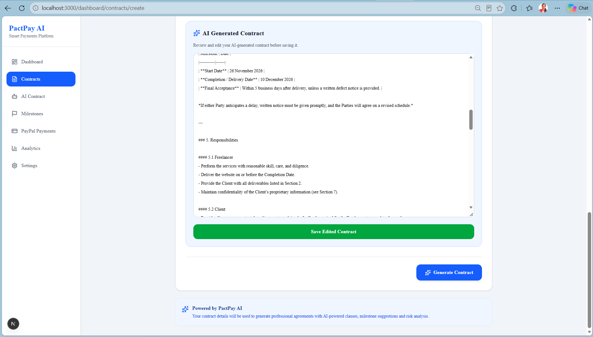
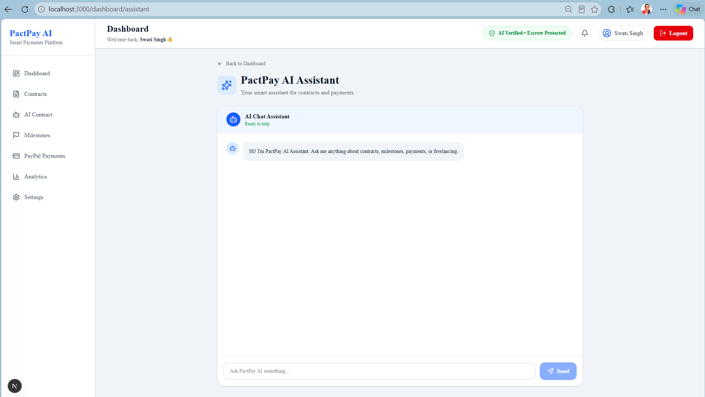
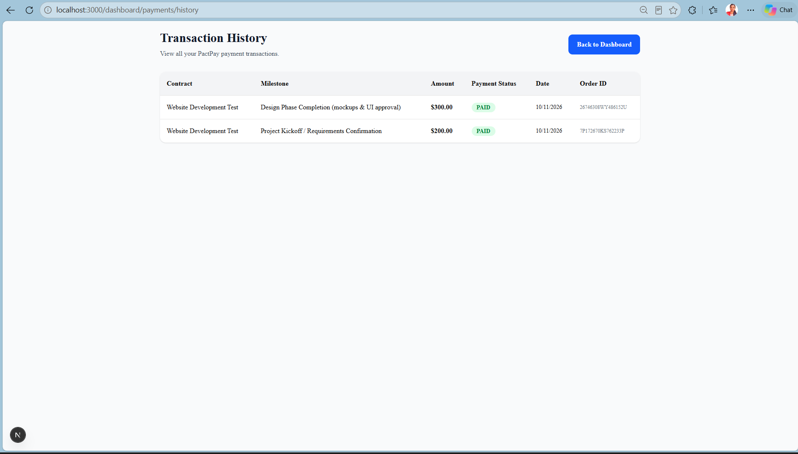

# 🚀 PactPay AI

### AI-Powered Contract Intelligence & Milestone-Based Payment Management

**Build Trust. Reduce Disputes. Get Paid with Confidence.**

PactPay AI is an AI-powered freelance contract management platform designed to simplify how freelancers and clients create agreements, manage project milestones, identify potential contractual risks, and track payments.

By combining AI-powered contract intelligence with PayPal payment integration, PactPay AI brings contract generation, project management, and payment tracking together in one centralized platform.

Built for the **PayPal AI Hackathon**, PactPay AI aims to make freelance collaboration more transparent, structured, and reliable.

---

---

# 🌐 Live Deployment

PactPay AI is deployed and accessible online.

- **Live Application:** [Open PactPay AI](https://pactpay-ai.vercel.app/)
- **Backend API:** https://pactpay-ai.onrender.com

**Deployment Platforms:**

- Frontend: Vercel
- Backend: Render
- Database: Supabase PostgreSQL

> Note: The backend may take a few seconds to respond after a period of inactivity due to Render's free-tier hosting.

---

# 📑 Table of Contents

1. [Problem Statement](#-problem-statement)
2. [Our Solution](#-our-solution)
3. [Key Features](#-key-features)
4. [Development Phases](#-development-phases)
5. [System Architecture](#-system-architecture)
6. [Database Design](#-database-design)
7. [Technology Stack](#-technology-stack)
8. [Installation & Setup](#-installation--setup)
9. [Environment Configuration](#-environment-configuration)
10. [API Documentation](#-api-documentation)
11. [Testing](#-testing)
12. [Application Screenshots](#-application-screenshots)
13. [Demo Video](#-demo-video)
14. [Future Enhancements](#-future-enhancements)
15. [Project Status](#-project-status)
16. [Hackathon Submission](#-hackathon-submission)

---

# 🎯 Problem Statement

Freelancers and clients often face challenges while managing project agreements and payments.

Common challenges include:

- **Unclear Project Scope:** Misunderstandings about deliverables, responsibilities, and expectations.
- **Time-Consuming Contracts:** Manually drafting professional agreements requires time and effort.
- **Contractual Risks:** Important terms and unclear clauses may go unnoticed.
- **Poor Milestone Tracking:** Managing project progress and deliverables can become difficult.
- **Payment Uncertainty:** Tracking payment progress and maintaining transparency can be challenging.

These challenges can lead to misunderstandings, payment delays, and disputes between freelancers and clients.

---

# 💡 Our Solution

PactPay AI provides a centralized platform that combines AI-powered contract intelligence, milestone management, and payment tracking.

The platform enables users to:

- Generate structured freelance contract drafts using Groq AI.
- Analyze contracts to identify potential risks and unclear terms.
- Generate concise AI-powered contract summaries.
- Review, edit, save, and retrieve generated contracts.
- Generate and manage project milestones.
- Create and capture payments through PayPal Sandbox.
- Track payment transactions and milestone status.
- Monitor contract and payment activity through an analytics dashboard.
- Interact with an AI assistant for platform-related guidance.

---

# ✨ Key Features

## 1. AI-Powered Contract Management

- Generate structured freelance contracts using Groq AI.
- Analyze contracts to identify potential risks.
- Generate AI-powered contract summaries.
- Review and edit generated contract content.
- Save and retrieve AI-generated contracts.

## 2. Milestone Management

- Generate project milestones.
- Organize project deliverables.
- Track milestone progress.
- Update milestone status based on successful payment completion.

## 3. PayPal Payment Integration

- PayPal Sandbox integration using the official Server SDK.
- Create and capture PayPal payment orders.
- Handle payment status updates through webhooks.
- Maintain payment statuses: `PENDING`, `PAID`, and `FAILED`.
- Update associated milestone status after successful payment.
- View transaction history.
- Payment success and cancellation pages.

**Note:** Payment functionality is integrated with PayPal Sandbox for testing. Production payment deployment is not claimed.

## 4. AI Chat Assistant

- Interactive AI chat interface.
- Groq-powered responses.
- JWT-protected chat API.
- Loading and error states.

## 5. Analytics Dashboard

- Dynamic dashboard statistics.
- Payment status visualization.
- Contract status visualization.
- Project completion statistics.
- Recent contracts table with filters.
- Responsive dashboard layout.

## 6. Authentication & Security

- User registration and login.
- JWT-based authentication.
- Protected backend API routes.
- Password hashing.
- Environment-based configuration for sensitive credentials.

---

# 🛠️ Development Phases

PactPay AI was developed through the following implementation phases.

## Phase 1: Foundation & Authentication

- Set up the Next.js frontend.
- Set up the Express.js and TypeScript backend.
- Configure PostgreSQL with Supabase.
- Integrate Prisma ORM.
- Implement user registration and login.
- Configure JWT authentication and protected routes.
- Build the initial dashboard interface.

## Phase 2: AI-Powered Contract Management

- Develop the contract creation interface.
- Implement contract form validation.
- Integrate Groq AI.
- Implement AI contract generation.
- Add AI-powered contract risk analysis.
- Add contract summaries and milestone generation.
- Implement contract editing and saving.
- Store and retrieve generated contracts.

## Phase 3: PayPal Payment Integration

- Configure PayPal Sandbox.
- Integrate the PayPal Server SDK.
- Implement payment order creation and capture.
- Configure PayPal webhooks.
- Synchronize payment and milestone statuses.
- Build payment success and cancellation pages.
- Implement transaction history.
- Test the payment workflow using Sandbox transactions.

## Phase 4: AI Assistant & Analytics Dashboard

- Develop the AI chat assistant backend API.
- Build the interactive AI assistant interface.
- Implement dashboard analytics APIs.
- Connect dashboard cards to backend data.
- Add payment and contract charts.
- Implement project completion statistics.
- Add dashboard filters.
- Improve AG Grid table responsiveness.
- Implement loading and error states.

## Phase 5: Responsive Design, UI Polish & Testing

- Improve responsive dashboard layouts.
- Optimize the AI assistant for mobile screens.
- Improve the Recent Contracts table layout.
- Polish the dashboard navigation and top navbar.
- Test dashboard, contracts, payments, and AI assistant modules.
- Verify loading and error handling.
- Perform frontend and backend build checks.

---

# 🏗️ System Architecture

PactPay AI follows a client-server architecture that connects the frontend, backend, database, AI services, and payment gateway.



---

# 🗄️ Database Design

PactPay AI uses PostgreSQL hosted on Supabase with Prisma ORM for database management.

The database supports the following core entities:

- **Users:** Stores user account and authentication-related information.
- **Contracts:** Stores generated contracts and associated project information.
- **Milestones:** Stores project deliverables and milestone statuses.
- **Payments:** Stores payment transaction details and payment statuses.
- **Chat History:** Stores AI assistant conversation data, where implemented.

---

# 💻 Technology Stack

## Frontend

- Next.js
- React.js
- TypeScript
- Tailwind CSS
- AG Grid
- Recharts

## Backend

- Node.js
- Express.js
- TypeScript
- Prisma ORM
- JWT Authentication

## Database

- PostgreSQL
- Supabase

## Artificial Intelligence

- Groq AI

## Payment Integration

- PayPal Server SDK
- PayPal Sandbox
- PayPal Webhooks

## Development Tools

- Visual Studio Code
- Git
- GitHub
- npm

---

# ⚙️ Installation & Setup

Follow these steps to run PactPay AI locally.

## Prerequisites

Make sure the following tools and services are available:

- Node.js
- npm
- Git
- PostgreSQL database through Supabase
- Groq API Key
- PayPal Sandbox Account

## 1. Clone the Repository

```bash
git clone <https://github.com/swati-singh2026/pactpay-ai>
cd PactPay-AI
```

## 2. Install Dependencies

Install frontend dependencies:

```bash
cd client
npm install
```

Install backend dependencies:

```bash
cd ../server
npm install
```

## 3. Configure Environment Variables

Create `.env` files in the respective client and server directories.

Refer to the Environment Configuration section below.

## 4. Configure Database

Run the Prisma commands from the server directory:

```bash
npx prisma generate
npx prisma migrate dev
```

Use the migration command according to your existing database setup.

## 5. Start the Backend

```bash
cd server
npm run dev
```

## 6. Start the Frontend

Open another terminal:

```bash
cd client
npm run dev
```

Open the local frontend URL displayed in your terminal.

---

# 🔐 Environment Configuration

Configure the following environment variables according to your project setup.

## Backend Environment Variables

```env
DATABASE_URL=
DIRECT_URL=
JWT_SECRET=
GROQ_API_KEY=
PAYPAL_CLIENT_ID=
PAYPAL_CLIENT_SECRET=
PAYPAL_MODE=sandbox
PAYPAL_BASE_URL=
PAYPAL_WEBHOOK_ID=
```

## Frontend Environment Variables

```env
NEXT_PUBLIC_API_URL=
NEXT_PUBLIC_PAYPAL_CLIENT_ID=
```

**Security Note:**

- Never commit `.env` files to GitHub.
- Never expose private API keys or payment credentials.
- Keep sensitive credentials restricted to the backend.

---

# 🔌 API Documentation

PactPay AI provides backend APIs for authentication, contract management, AI services, milestones, payments, and dashboard analytics.

## Authentication APIs

| Method | Endpoint             | Description         |
| ------ | -------------------- | ------------------- |
| POST   | `/api/auth/register` | Register a new user |
| POST   | `/api/auth/login`    | Authenticate a user |

## Contract Management APIs

| Method | Endpoint             | Description                  |
| ------ | -------------------- | ---------------------------- |
| GET    | `/api/contracts`     | Retrieve contracts           |
| POST   | `/api/contracts`     | Create a contract            |
| GET    | `/api/contracts/:id` | Retrieve a specific contract |
| PUT    | `/api/contracts/:id` | Update a contract            |

## AI APIs

| Method | Endpoint           | Description                     |
| ------ | ------------------ | ------------------------------- |
| POST   | `/api/ai/generate` | Generate an AI-powered contract |
| POST   | `/api/ai/analyze`  | Analyze contractual risks       |
| POST   | `/api/ai/summary`  | Generate a contract summary     |

## Payment APIs

| Method | Endpoint                      | Description              |
| ------ | ----------------------------- | ------------------------ |
| POST   | `/api/payments/create-order`  | Create a PayPal order    |
| POST   | `/api/payments/capture-order` | Capture a PayPal payment |
| GET    | `/api/payments/history`       | Retrieve payment history |

## Dashboard APIs

| Method | Endpoint               | Description                   |
| ------ | ---------------------- | ----------------------------- |
| GET    | `/api/dashboard/stats` | Retrieve dashboard statistics |

## **Note:** Verify endpoint names and HTTP methods against the actual backend routes before submission. Only include implemented endpoints.

# 🧪 Testing

PactPay AI includes testing and verification of its core application modules.

The following areas are covered:

- User registration and authentication.
- AI contract generation.
- Contract risk analysis and summaries.
- Contract creation and retrieval.
- Milestone generation and status management.
- PayPal Sandbox payment creation and capture.
- Payment transaction history.
- AI assistant interactions.
- Dashboard statistics and visualizations.
- Frontend and backend integration.

---

# 📸 Application Screenshots

## Dashboard







## AI Contract Generation





## AI Assistant



## Payment Management



---

# 🎥 Demo Video

The project demonstration video showcases the major features and workflows of PactPay AI.

**Watch the Demo:** [Add Your Demo Video Link Here](YOUR_VIDEO_LINK)

---

# 🚀 Future Enhancements

- Production deployment and live payment integration.
- Advanced contract risk detection.
- Enhanced payment automation.
- Improved milestone-based payment workflows.
- Additional analytics and reporting capabilities.
- Further improvements to application scalability and performance.

---

# 📊 Project Status

| Component                  | Status      |
| -------------------------- | ----------- |
| Frontend Development       | Completed   |
| Backend Development        | Completed   |
| User Authentication        | Implemented |
| AI Contract Generation     | Implemented |
| Contract Risk Analysis     | Implemented |
| Milestone Management       | Implemented |
| PayPal Sandbox Integration | Implemented |
| AI Assistant               | Implemented |
| Analytics Dashboard        | Implemented |
| Application Testing        | completed   |
| Production Deployment      | completed   |
| Demo Video                 | completed   |

---

# 🏆 Hackathon Submission

**Project:** PactPay AI

**Category:** AI-Powered Freelance Contract & Payment Management

**Payment Integration:** PayPal Sandbox

**AI Integration:** Groq AI

Built with the goal of making freelance agreements more transparent, contract management more efficient, and milestone-based payments easier to track.
