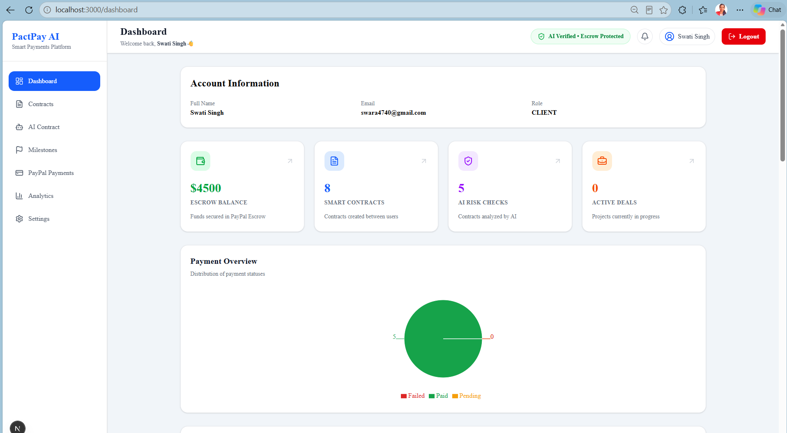
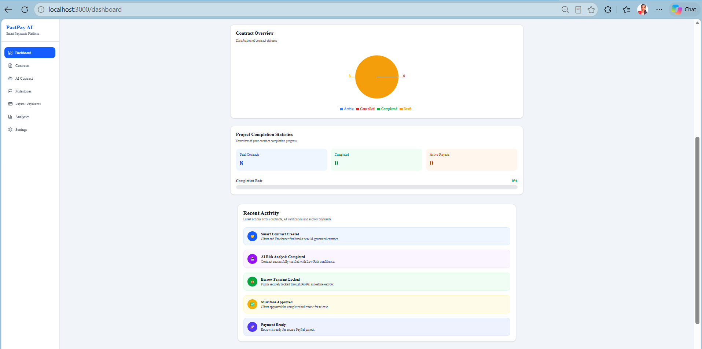
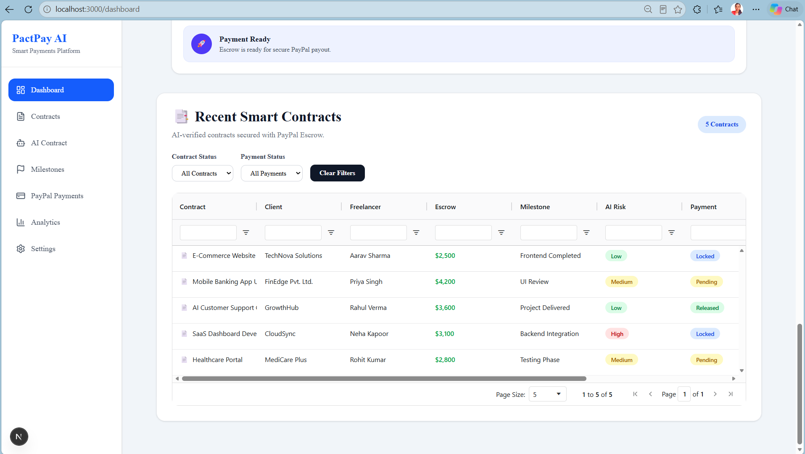
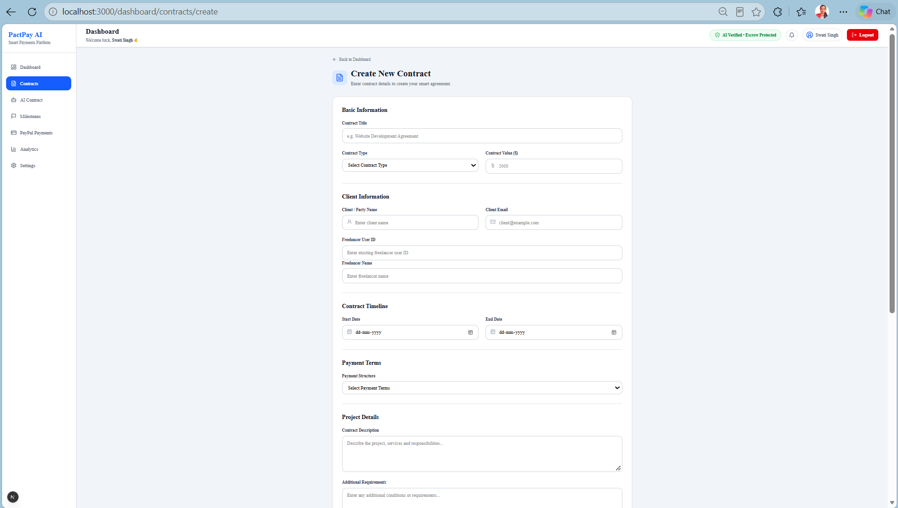
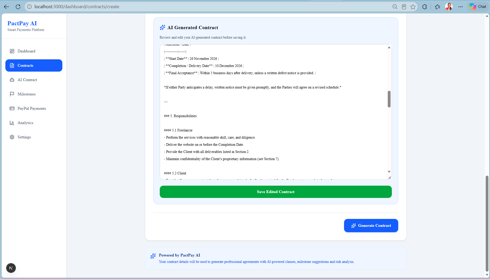
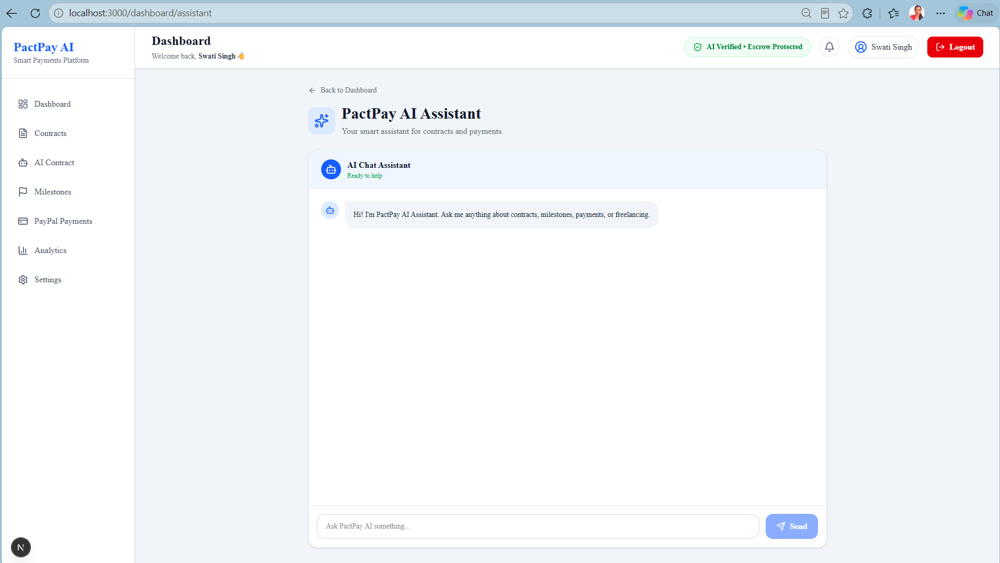
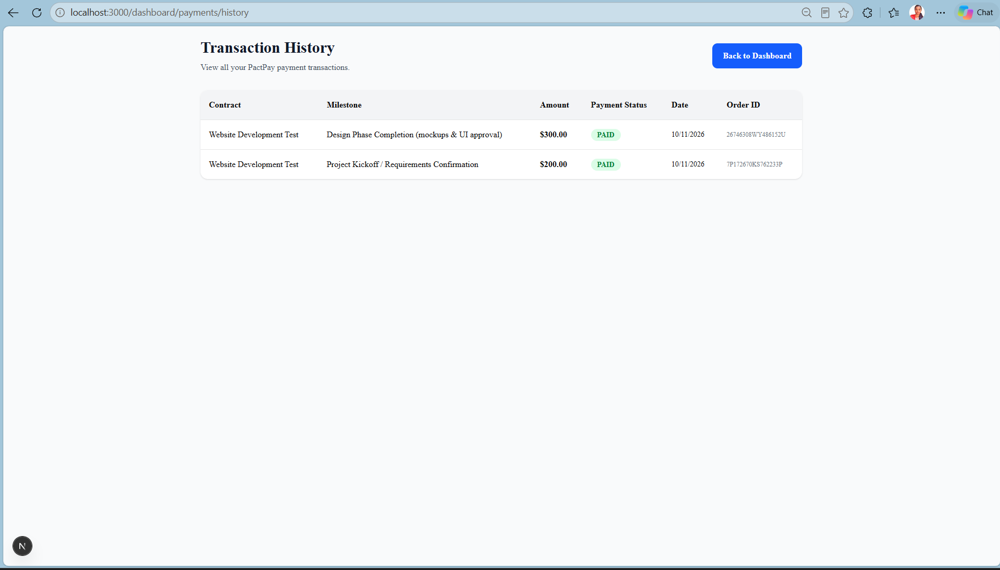

# 🚀 PactPay AI

### AI-Powered Contract Intelligence & Milestone-Based Payments for Freelancers

**Build Trust. Reduce Disputes. Get Paid with Confidence.**

PactPay AI is an AI-powered freelance contract management platform designed to simplify how freelancers and clients create agreements, manage project milestones, identify contractual risks, and track payments.

By combining AI-powered contract intelligence with PayPal payment integration, PactPay AI brings contract generation, project management, and payment tracking together in one centralized platform.

Built for the **PayPal AI Hackathon**, PactPay AI aims to make freelance collaboration more transparent, structured, and trustworthy.

---

---

# 🌐 Live Deployment

PactPay AI is deployed and accessible online.

- **Live Application (Frontend):** [Open PactPay AI](PASTE_YOUR_VERCEL_URL_HERE)
- **Backend API:** https://pactpay-ai.onrender.com

**Deployment Platforms:**

- Frontend: Vercel
- Backend: Render
- Database: Supabase PostgreSQL

> **Note:** The backend may take a few seconds to respond after a period of inactivity because of Render's free-tier instance behavior.

---

# 📑 Table of Contents

- [About PactPay AI](#-pactpay-ai)
- [Problem Statement](#-problem-statement)
- [Our Solution](#-our-solution)
- [Key Features](#-key-features)
- [System Architecture](#-system-architecture)
- [Database Design](#-database-design)
- [Security Architecture](#-security-architecture)
- [Technology Stack](#-technology-stack)
- [Installation & Setup Guide](#-installation--setup-guide)
- [Environment Configuration](#-environment-configuration)
- [API Documentation](#-api-documentation)
- [Testing](#-testing)
- [Application Screenshots](#-application-screenshots)
- [Demo Video](#-demo-video)
- [Hackathon Submission](#-hackathon-submission)
- [Future Enhancements](#-future-enhancements)
- [Project Status](#-project-status)
- [Developer](#-developer)

---

# 🎯 Problem Statement

The freelance industry is growing rapidly, but managing agreements and payments remains challenging for both freelancers and clients.

Some common problems include:

- **Unclear Project Scope:** Misunderstandings about deliverables, responsibilities, and expectations.
- **Time-Consuming Contracts:** Creating professional freelance agreements manually takes time and effort.
- **Payment Uncertainty:** Freelancers may face delayed payments or unclear payment terms.
- **Poor Milestone Tracking:** Managing project progress and deliverables can become difficult.
- **Contractual Risks:** Important terms and potential risks may go unnoticed.
- **Lack of Transparency:** Clients and freelancers may struggle to track project and payment progress.

These challenges can lead to disputes, delayed payments, and a lack of trust between freelancers and clients.

---

# 💡 Our Solution

PactPay AI provides an integrated platform to simplify freelance contract management and milestone-based payment tracking.

Our solution combines AI-powered tools and payment integration to make freelance collaboration more organized and transparent.

### Key Solutions

- **AI-Powered Contract Generation:** Generate structured freelance contract drafts using Groq AI.
- **Contract Risk Analysis:** Identify potential risks and unclear terms in contracts.
- **AI Contract Summaries:** Understand important contract details through AI-generated summaries.
- **Milestone Management:** Generate and organize project milestones.
- **PayPal Payment Integration:** Create, capture, and track payments using PayPal Sandbox.
- **Analytics Dashboard:** Monitor contract statistics, payment activity, and project progress.
- **AI Assistant:** Get AI-powered assistance for contract, milestone, payment, and freelancing-related questions.

Our goal is to build a more transparent and trustworthy freelance ecosystem where agreements, milestones, and payments are easier to manage.

---

# ✨ Key Features

## 1. AI-Powered Contract Management

- Generate structured freelance contract drafts using Groq AI.
- Analyze contracts to identify potential risks and unclear terms.
- Generate AI-powered contract summaries.
- Edit and review AI-generated contract content.
- Save and retrieve generated contracts.

## 2. Milestone Management

- Generate project milestones using AI.
- Organize project deliverables into manageable stages.
- Track milestone progress and completion status.
- Connect milestone records with payment workflows.

## 3. PayPal Payment Integration

- Create PayPal Sandbox payment orders.
- Capture payments through the backend.
- Track payment statuses: Pending, Paid, and Failed.
- Update payment and milestone records after successful capture.
- Handle PayPal webhook events.
- View transaction history.

> **Note:** PayPal integration currently uses Sandbox mode for development and testing. It is not a production escrow service.

## 4. AI Assistant

- Interactive AI-powered chat interface.
- Get assistance with freelance contracts and milestones.
- Ask questions about payment workflows and project management.
- Secure, authenticated API access.

## 5. Analytics Dashboard

- Contract statistics and status overview.
- Payment analytics with visual charts.
- Contract completion statistics.
- Revenue and project activity summaries.
- Recent contracts table with filtering options.

## 6. Secure Authentication

- User registration and login.
- JWT-based authentication.
- Protected backend API routes.
- Authenticated access to dashboard features.

---

# 🏗️ System Architecture

PactPay AI follows a client-server architecture that separates the frontend, backend, database, and external AI/payment services.

## Architecture Overview

The platform consists of four major components:

1. **Frontend:** Provides the user interface for contract management, AI assistance, payments, and analytics.
2. **Backend:** Handles business logic, authentication, contract operations, AI requests, and payment processing.
3. **Database:** Stores user, contract, milestone, and payment information.
4. **External Services:** Integrates Groq AI for intelligent contract assistance and PayPal Sandbox for payment processing.

## Architecture Diagram

```text
                 ┌──────────────────────────┐
                 │          USER            │
                 │    Freelancer / Client   │
                 └────────────┬─────────────┘
                              │
                              ▼
                 ┌──────────────────────────┐
                 │       FRONTEND           │
                 │                          │
                 │       Next.js            │
                 │       React               │
                 │       TypeScript          │
                 │       Tailwind CSS        │
                 │                          │
                 └────────────┬─────────────┘
                              │
                         REST APIs
                              │
                              ▼
                 ┌──────────────────────────┐
                 │        BACKEND           │
                 │                          │
                 │       Express.js         │
                 │       TypeScript         │
                 │                          │
                 │   JWT Authentication     │
                 │   Contract Management    │
                 │   Milestone Management   │
                 │   AI Services            │
                 │   Payment Services       │
                 └───────┬─────────┬────────┘
                         │         │
               ┌─────────▼───┐ ┌───▼────────────┐
               │  DATABASE   │ │ EXTERNAL APIs  │
               │             │ │                │
               │ PostgreSQL  │ │ Groq AI        │
               │ Supabase    │ │ PayPal Sandbox │
               │ Prisma ORM  │ │                │
               └─────────────┘ └────────────────┘
```

## 🔄 Application Workflow

PactPay AI follows a structured workflow that connects users, AI-powered services, contract management, and payment processing.

1. **User Authentication:** Users register or log in to access the platform.
2. **Frontend Communication:** The Next.js frontend communicates with the Express.js backend through REST APIs.
3. **Secure Access:** JWT authentication protects authorized application routes and API endpoints.
4. **Contract Management:** Users can create, generate, edit, and manage freelance contracts.
5. **AI Processing:** Groq AI powers contract generation, risk analysis, contract summaries, and AI chat assistance.
6. **Data Storage:** Contract and milestone information is stored in PostgreSQL.
7. **Payment Processing:** The backend communicates with PayPal Sandbox to create and capture payment orders.
8. **Payment Updates:** Payment and milestone statuses are updated in the database following successful payment processing.
9. **Analytics & Monitoring:** The dashboard displays contract statistics, payment analytics, and project progress.

---

# 🗄️ Database Design

PactPay AI uses **PostgreSQL** as its relational database, **Supabase** for database hosting, and **Prisma ORM** for database access and schema management.

## Core Database Models

### 1. User Model

Stores user account and authentication information.

- User ID
- Name
- Email
- Password (securely hashed)
- Account timestamps

### 2. Contract Model

Stores freelance contract information and associated user relationships.

- Contract ID
- Contract title
- Contract description
- Contract amount
- Contract status
- Client relationship
- Freelancer relationship
- Created and updated timestamps

### 3. Milestone Model

Stores project milestone information and progress details.

- Milestone ID
- Milestone title and description
- Milestone amount
- Milestone status
- Associated contract

### 4. Payment Model

Stores payment transaction information and PayPal references.

- Payment ID
- Payment amount
- Payment status
- PayPal order reference
- Associated contract and milestone
- Transaction timestamps

## Database Relationships

The database uses relational connections to maintain consistency between users, contracts, milestones, and payments.

- A user can be associated with multiple contracts.
- Each contract is associated with its client and freelancer.
- A contract can contain multiple milestones.
- Milestones are associated with payment records.
- Payment records maintain transaction statuses and PayPal references.

## Database Technologies

| Technology | Purpose                               |
| ---------- | ------------------------------------- |
| PostgreSQL | Relational database                   |
| Supabase   | Hosted PostgreSQL database            |
| Prisma ORM | Database access and schema management |

---

# 🔐 Security Architecture

Security is an important part of PactPay AI's application architecture. The platform incorporates the following security practices:

- **JWT Authentication:** Protects authenticated API endpoints.
- **Password Hashing:** Protects stored user passwords.
- **Protected Routes:** Restricts access to authorized users.
- **Environment Variables:** Keeps API credentials and sensitive configuration outside the source code.
- **Backend Payment Processing:** Handles PayPal order creation and capture through the server.
- **Webhook Handling:** Processes supported PayPal payment events and updates transaction records.

---

# 🛠️ Technology Stack

PactPay AI is built using modern frontend, backend, database, and AI technologies to provide an interactive freelance contract management experience.

## Frontend

| Technology   | Purpose                                    |
| ------------ | ------------------------------------------ |
| Next.js      | Frontend framework                         |
| React.js     | User interface development                 |
| TypeScript   | Type-safe frontend development             |
| Tailwind CSS | Styling and responsive design              |
| AG Grid      | Interactive contract data tables           |
| Recharts     | Dashboard analytics and data visualization |
| Lucide React | UI icons                                   |

## Backend

| Technology        | Purpose                                       |
| ----------------- | --------------------------------------------- |
| Node.js           | JavaScript runtime                            |
| Express.js        | Backend framework and REST APIs               |
| TypeScript        | Type-safe backend development                 |
| Prisma ORM        | Database queries and management               |
| JWT               | User authentication                           |
| Groq SDK          | AI-powered contract generation and assistance |
| PayPal Server SDK | PayPal payment order creation and capture     |

## Database & External Services

| Technology     | Purpose                          |
| -------------- | -------------------------------- |
| PostgreSQL     | Relational database              |
| Supabase       | PostgreSQL database hosting      |
| Groq AI        | AI-powered contract intelligence |
| PayPal Sandbox | Payment integration and testing  |

## Development Tools

| Tool               | Purpose             |
| ------------------ | ------------------- |
| Visual Studio Code | Code editor         |
| Git                | Version control     |
| GitHub             | Source code hosting |
| Postman            | API testing         |
| npm                | Package management  |

---

# 🚀 Installation & Setup Guide

Follow these steps to run PactPay AI locally.

## Prerequisites

Make sure the following tools are installed:

- Node.js
- npm
- Git
- Visual Studio Code
- PostgreSQL / Supabase account

## 1. Clone the Repository

```bash
git clone https://github.com/swati-singh2026/pactpay-ai.git
```

## 2. Navigate to the Project

```bash
cd pactpay-ai
```

## 3. Backend Setup

Open a terminal and navigate to the server directory:

```bash
cd server
```

Install dependencies:

```bash
npm install
```

Configure the backend environment variables using your project's environment configuration.

Set up the required database connection, JWT configuration, Groq API credentials, and PayPal Sandbox credentials.

Run Prisma migrations if required:

```bash
npx prisma migrate dev
```

Start the backend development server:

```bash
npm run dev
```

## 4. Frontend Setup

Open another terminal and navigate to the client directory:

```bash
cd client
```

Install dependencies:

```bash
npm install
```

Configure the frontend environment variables according to your project configuration.

Start the frontend development server:

```bash
npm run dev
```

## 5. Access the Application

Once both development servers are running, open:

**Frontend:**

http://localhost:3000

**Backend:**

http://localhost:5000

---

# ⚙️ Environment Configuration

PactPay AI requires environment variables for database connectivity, authentication, AI services, and payment integration.

Configure the following values in the appropriate backend and frontend environment files:

- Database connection string
- JWT secret
- Groq API key
- PayPal Client ID
- PayPal Client Secret
- Frontend API base URL, if required by the frontend configuration

> **Security Note:** Never commit `.env` files, API keys, database credentials, or authentication secrets to GitHub. Use environment variables to protect sensitive configuration.

---

# 📡 API Documentation

PactPay AI uses RESTful APIs to connect the frontend with the backend and manage authentication, contracts, AI services, payments, and dashboard analytics.

## Base URL

```text
http://localhost:5000/api
```

## Authentication

Protected API endpoints require JWT authentication.

Include the access token in the request header:

```http
Authorization: Bearer <JWT_TOKEN>
```

## API Endpoints

### 1. Authentication APIs

| Method | Endpoint             | Description             | Authentication |
| ------ | -------------------- | ----------------------- | -------------- |
| POST   | `/api/auth/register` | Register a new user     | No             |
| POST   | `/api/auth/login`    | Log in an existing user | No             |

### 2. AI APIs

| Method | Endpoint           | Description                     | Authentication               |
| ------ | ------------------ | ------------------------------- | ---------------------------- |
| POST   | `/api/ai/chat`     | Interact with the AI assistant  | Yes                          |
| POST   | `/api/ai/generate` | Generate an AI-powered contract | As configured in the project |

### 3. Dashboard APIs

| Method | Endpoint         | Description                  | Authentication |
| ------ | ---------------- | ---------------------------- | -------------- |
| GET    | `/api/dashboard` | Retrieve dashboard analytics | Yes            |

### 4. Payment & Transaction APIs

| Method | Endpoint                      | Description                    | Authentication |
| ------ | ----------------------------- | ------------------------------ | -------------- |
| POST   | `/api/payments/create-order`  | Create a PayPal payment order  | Yes            |
| POST   | `/api/payments/capture-order` | Capture a PayPal payment order | Yes            |
| GET    | `/api/transactions`           | Retrieve transaction history   | Yes            |

> **Note:** Verify the exact route paths and HTTP methods against the current backend route files before publishing this endpoint table.

---

# 🧪 Testing

PactPay AI was tested locally to verify its main application workflows and integrations.

## Testing Tools

- **Postman:** Used for backend API testing.
- **Browser Testing:** Used to verify frontend pages and user interactions.
- **PayPal Sandbox:** Used to test payment order creation and capture.
- **Build Verification:** Used to check frontend and backend compilation.

## Tested Functionalities

### Authentication Testing

- User registration and login.
- JWT-based authentication.
- Access to protected API endpoints.
- Unauthorized request handling.

### AI Functionality Testing

- AI-powered contract generation.
- Contract risk analysis.
- AI-generated contract summaries.
- AI assistant chat responses.

### Payment Testing

- PayPal Sandbox order creation.
- Payment capture.
- Payment status updates.
- Milestone status updates after successful payment.
- Transaction history retrieval.
- Payment cancellation page.

### Dashboard Testing

- Dashboard analytics.
- Payment charts.
- Contract charts.
- Completion statistics.
- Contract table filters.
- Loading and error states.

### Responsive Design Testing

- Desktop layout.
- Mobile dashboard layout.
- AI Assistant mobile interface.
- Responsive contract table.

## Payment Testing Environment

Payments were tested using PayPal Sandbox accounts and test transactions.

> **Important:** Sandbox transactions are simulated test payments. They do not represent real financial transactions or production escrow operations.

---

# 📸 Application Screenshots

This section highlights the key interfaces and features of PactPay AI.

## 1. Dashboard

The dashboard provides an overview of contracts, payments, project activity, and analytics.

<!-- Add your dashboard screenshot here -->

### Dashboard Overview



### Dashboard Analytics



### Recent Smart Contracts



## 2. AI Contract Generation

Generate structured freelance contract drafts using AI.

<!-- Add your AI contract generation screenshot here -->





## 3. AI Assistant

Interact with the AI assistant to get help with contracts, milestones, payments, and freelancing-related questions.

<!-- Add your AI assistant screenshot here -->



## 4. Payment Management

Manage PayPal Sandbox payment workflows and view transaction history.

<!-- Add your payment screenshot here -->



---

# 🎥 Demo Video

Watch the PactPay AI demonstration to explore its main features and workflows.

<!-- Replace the placeholder below with your actual demo video link -->

**Demo Video:** Coming Soon

---

# 🏆 Hackathon Submission

## Hackathon

**PayPal AI Hackathon**

## Project Name

**PactPay AI**

## Project Description

PactPay AI is an AI-powered freelance contract management platform that combines intelligent contract generation, contract risk analysis, milestone management, and PayPal payment integration.

The platform aims to simplify freelance collaboration by making agreements more structured, project progress easier to track, and payment workflows more transparent.

## Built With

- Next.js
- React.js
- TypeScript
- Tailwind CSS
- Node.js
- Express.js
- PostgreSQL
- Supabase
- Prisma ORM
- Groq AI
- PayPal Server SDK
- Recharts
- AG Grid

## Project Repository

**GitHub:** [PactPay AI Repository](https://github.com/swati-singh2026/pactpay-ai)

---

# 🔮 Future Enhancements

PactPay AI aims to evolve into a more comprehensive freelance contract and payment management platform.

Potential future improvements include:

- **Production Payment Integration:** Move from PayPal Sandbox to a production payment environment after completing the required configuration and compliance checks.
- **Advanced AI Intelligence:** Improve contract analysis and risk detection with more detailed AI-powered insights.
- **Enhanced Milestone Tracking:** Introduce more advanced milestone progress tracking and project management capabilities.
- **Real-Time Notifications:** Notify users about payment updates, milestone progress, and important contract activities.
- **Advanced Analytics:** Provide deeper insights into contract performance, payment trends, and project activity.
- **Digital Contract Signing:** Explore secure digital signature integration.

---

# 📊 Project Status

PactPay AI has completed its core development and local testing workflows.

| Module                     | Status    |
| -------------------------- | --------- |
| User Authentication        | Completed |
| AI Contract Generation     | Completed |
| Contract Risk Analysis     | Completed |
| AI Contract Summaries      | Completed |
| Milestone Management       | Completed |
| PayPal Sandbox Integration | Completed |
| Transaction History        | Completed |
| AI Chat Assistant          | Completed |
| Analytics Dashboard        | Completed |
| Responsive UI              | Completed |
| Local Functional Testing   | Completed |
| Production Deployment      | completed |

---

# 🌟 Project Vision

Our vision is to make freelance collaboration more transparent, structured, and reliable.

By combining AI-powered contract intelligence with milestone-based payment workflows, PactPay AI aims to help freelancers and clients manage agreements and project payments with greater confidence.

**PactPay AI — Build Trust. Reduce Disputes. Get Paid with Confidence.**

---

# 👩‍💻 Developer

Developed as a project for the PayPal AI Hackathon.

**Project:** PactPay AI

**Source Code:** [GitHub Repository](https://github.com/swati-singh2026/pactpay-ai)

---
